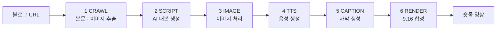
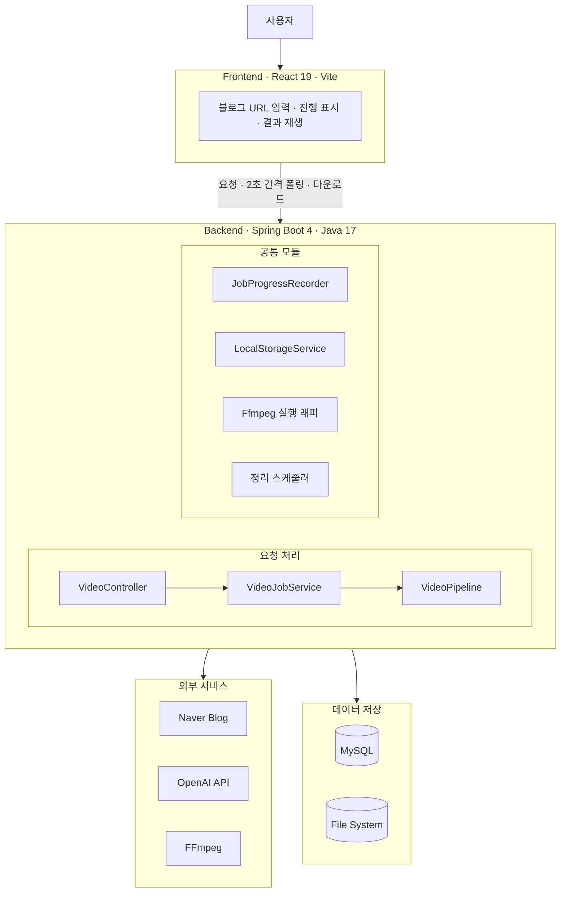

# Reelay

블로그 글을 생성형 AI로 **30~60초 9:16 숏폼 영상**으로 바꿔주는 웹서비스.

> (주)스마트동스쿨 기업실무체험 과제 - "블로그 콘텐츠를 활용한 생성형 AI 기반 숏폼 영상 제작 웹서비스 개발"

블로그 URL 하나를 넣으면 본문 추출부터 영상 합성까지 한 번에 이어집니다.
수작업으로 약 60분 걸리던 숏폼 제작을 약 10분으로 줄이는 것이 목표입니다.

<!-- 데모 영상 링크 또는 GIF -->

## 동작 방식



| 단계 | 하는 일 |
|---|---|
| CRAWL | 네이버 블로그에서 제목·본문·이미지를 추출한다. 비공개·삭제된 글은 즉시 실패로 구분한다 |
| SCRIPT | 본문을 LLM에 넘겨 훅 - 본문 - 엔딩 구조의 대본을 만든다. 문장당 15~25자로 제한해 분량을 맞춘다 |
| IMAGE | 블로그에 있던 이미지를 장면에 배치한다. 쓸 이미지가 없으면 타이포그래피 카드로 대체한다 |
| TTS | 장면별 음성을 만들고 길이를 실측해 장면 길이로 쓴다 |
| CAPTION | 자막을 만든다. 폭을 계산해 2줄로 접고 키워드를 강조한다 |
| RENDER | 장면별로 렌더한 뒤 이어 붙이고 음성을 합친다. 1080x1920, Ken Burns 5종 |

이미지는 **AI로 새로 생성하지 않습니다.** 블로그에 이미 있는 이미지만 재활용합니다.

## 시스템 구조



영상 생성은 수십 초에서 몇 분이 걸려 HTTP 요청 하나로 버틸 수 없습니다.
요청을 받으면 **작업 번호를 즉시 돌려주고**(`202 Accepted`) 파이프라인은 별도 스레드에서 실행합니다.
화면은 2초 간격으로 상태를 조회해 6단계 체크리스트를 그립니다.

## 기술 스택

| | |
|---|---|
| Backend | Java 17, Spring Boot 4, Spring AI (OpenAI), Spring Data JPA, Flyway, MySQL 8.4, Jsoup |
| Frontend | React 19, Vite |
| 영상 처리 | FFmpeg |

## 실행 방법

### 요구사항

- JDK 17 이상
- MySQL 8.4 (스키마 `reelay`, utf8mb4)
- **FFmpeg** - `ffmpeg`, `ffprobe`가 PATH에 잡혀 있어야 합니다
- Node.js 20 이상
- OpenAI API 키

### 환경 변수

| 변수 | 기본값 | 설명 |
|---|---|---|
| `SPRING_AI_OPENAI_API_KEY` | (필수) | OpenAI API 키 |
| `SPRING_DATASOURCE_URL` | `jdbc:mysql://localhost:3306/reelay` | DB 주소 |
| `SPRING_DATASOURCE_USERNAME` | `root` | DB 계정 |
| `SPRING_DATASOURCE_PASSWORD` | (빈 값) | DB 비밀번호 |
| `REELAY_CORS_ALLOWED_ORIGINS` | `http://localhost:5173` | 허용할 프론트엔드 출처 |
| `REELAY_SCRIPT_MODEL` | `gpt-4o-mini` | 대본 생성 모델 |
| `REELAY_TTS_VOICE` | `nova` | TTS 목소리 |

비밀값은 `BE/src/main/resources/application-local.properties`에 두세요. `.gitignore` 대상입니다.
생성된 이미지·음성·영상은 `~/.reelay/storage`에 쌓입니다. `reelay.storage.root`로 바꿀 수 있습니다.

### 실행

```bash
cd BE && ./gradlew bootRun
```

```bash
cd FE && npm install && npm run dev
```

```bash
cd BE && ./gradlew test
```

네이버 실제 응답을 쓰는 테스트는 `./gradlew networkTest`로 분리돼 있습니다.

## API

Base URL `/api/videos` · 인증 없음 (작업 번호를 아는 사람이 소유자)

| 메서드 | 경로 | 설명 |
|---|---|---|
| `POST` | `/api/videos` | 영상 생성 요청. `202` + 작업 번호를 즉시 반환 |
| `GET` | `/api/videos/{jobId}` | 진행 상태 조회. 6단계 체크리스트와 결과를 함께 준다 |
| `GET` | `/api/videos/{jobId}/file` | 결과 영상. 구간 탐색 지원, `?download=true`면 첨부파일 |
| `GET` | `/api/videos/{jobId}/scenes/{cutOrder}/image` | 장면 이미지 |

실패한 작업도 `200`으로 응답합니다. 조회 자체는 성공했고 실패는 데이터이기 때문입니다.

## 개발 현황

| 영역 | 상태 |
|---|---|
| CRAWL 블로그 크롤링 | 완료 |
| SCRIPT AI 대본 생성 | 완료 |
| IMAGE 이미지 처리 | 진행 중 |
| TTS 음성 생성 | 완료 |
| CAPTION 자막 생성 | 진행 중 |
| RENDER 영상 합성 | 완료 |
| REST API · 작업 상태 추적 | 완료 |
| 프론트엔드 화면 | 완료 |
| 프론트엔드 - 백엔드 연동 | 진행 중 |
